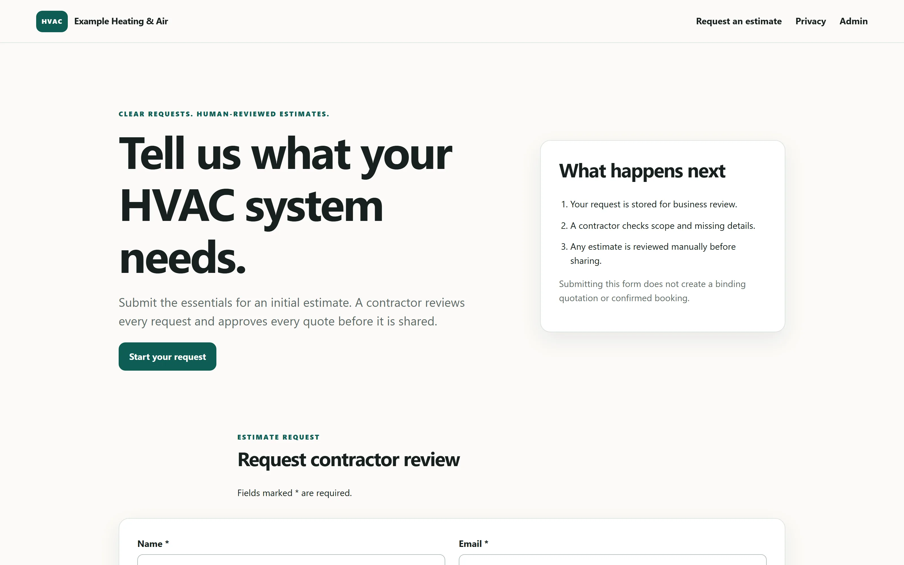
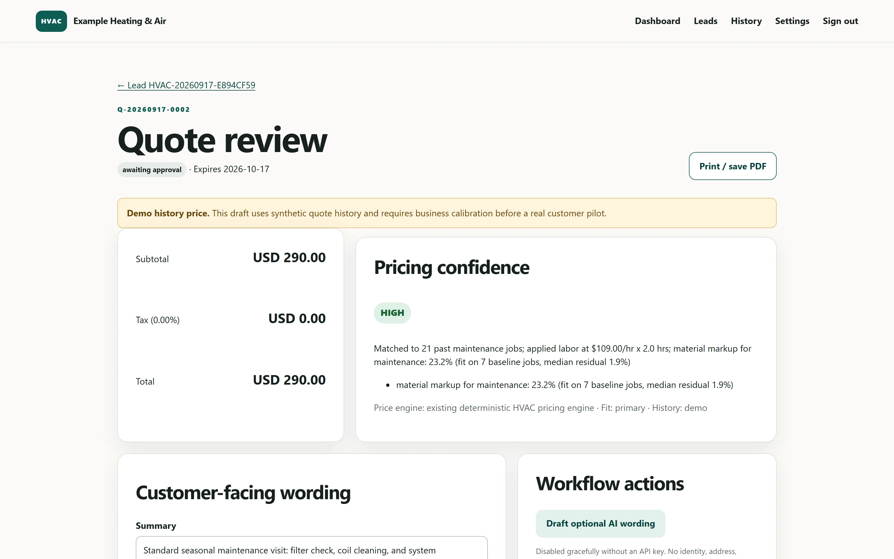
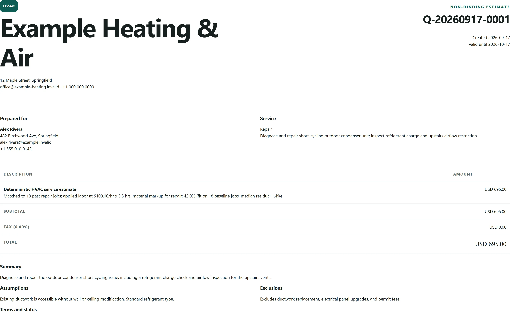
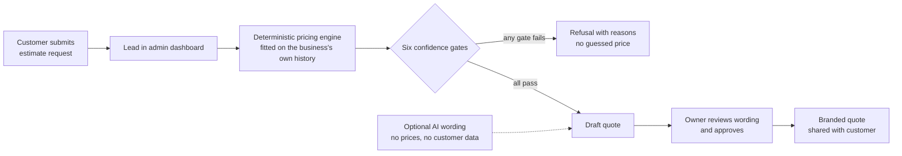

# Service-Business Quote Agent

**A controlled quotation workflow for service businesses, from lead intake through human-approved quote generation.**

Status: **Pilot candidate**, running as a local demo on synthetic pricing history, with no customer pilot yet. Built by [Samir Mammadli](https://samir-mammadli.vercel.app).

> This is a **showcase repository**. It explains the product with screenshots, architecture and short code excerpts. The full source code is private and available on request for hiring or business conversations via [LinkedIn](https://www.linkedin.com/in/samirmammadli) or the [contact page](https://samir-mammadli.vercel.app/contact).

[Product page](https://samir-mammadli.vercel.app/products/service-business-quote-agent) · [Full case study](https://samir-mammadli.vercel.app/work/service-business-quote-agent) · **[Business analysis: requirements, rules & acceptance criteria](case-study/README.md)** · [Article: why it refuses to guess](case-study/refuse-instead-of-guess.md)

---

## The problem

Small service businesses lose leads when quotes are slow, and they lose margin when prices are inconsistent. Pricing often lives in one person's head, with no record of why a number was given.

## What it does


*The customer-facing intake form. No login is required.*

- Mobile-friendly public estimate request with consent, a honeypot, and rate limiting
- Password-protected admin dashboard with lead notes, statuses, and CSV export
- **Deterministic price quote** from a fitted pricing model with **six confidence gates**. AI cannot set or alter prices.
- Explicit approval workflow tracked through `draft → awaiting_approval → approved → shared → accepted / rejected / expired`
- Branded print-to-PDF quote output
- Preview-first historical CSV import with duplicate protection and an atomic commit


*Every quote shows its pricing confidence and waits for a typed approval.*


*The finished output: a branded, customer-ready estimate.*

## How it works



The engine fits labor rate, category markup, repeat-customer discount and seasonal effects from validated past quotes. Before it returns a price, it checks that:

1. the job matches a known service category,
2. that category has an accepted pricing rule,
3. the job's scope falls within the historical range,
4. there are enough comparable past jobs,
5. pricing in that category is consistent, and
6. any discount or surcharge rule the job needs is itself accepted.

If any check fails, the system **declines to give a firm price** and says which checks failed. It never invents a number.

## Design decisions

| Decision | Why |
|---|---|
| AI never touches price | Prices come only from the business's own data, so every number can be explained and defended. |
| Refuse instead of guess | A wrong quote costs margin or trust. "Not enough comparable history" is a valid, useful answer. |
| Human approval is mandatory | Nothing reaches a customer without an owner's explicit approval, and every state change is recorded. |
| Minimal data to the AI | The optional wording assistant receives only the service category, equipment and description. It never receives a customer's name, address or contact details, or the price, and it is fully off without a server-side key. |
| Money as integer cents | Avoids floating-point rounding errors in totals and tax. |

## Code excerpts

The approval workflow is an explicit state machine. A quote can only move along allowed paths, and each move is written to an audit table:

```python
TRANSITIONS = {
    "draft": {"awaiting_approval"},
    "awaiting_approval": {"draft", "approved"},
    "approved": {"shared", "rejected", "expired"},
    "shared": {"accepted", "rejected", "expired"},
    "accepted": set(),
    "rejected": set(),
    "expired": set(),
}

def transition_quote(quote_id: int, admin_id: int, target: str) -> None:
    ...
    if target not in TRANSITIONS.get(current, set()):
        raise ValueError(f"invalid quote transition from {current} to {target}")
    if target == "approved" and not str(quote["customer_message"]).strip():
        raise ValueError("add customer-facing wording before approval")
    ...  # status update + audit event in one transaction
```

The confidence gate. Data support decides, and any failed check means no firm price:

```python
confident = all(passed for _, passed, _ in checks)
if confident:
    price, applied = price_with_rules(dict(job, category=cat), fitted)
    result["firm_price"] = price
    result["justification"] = f"Matched to {n_comp} past {cat} jobs; applied " + "; ".join(applied)
else:
    failed = [c for c, p, _ in checks if not p]
    result["firm_price"] = None
    result["declined_because"] = failed
```

## Tech stack

Python · Flask · SQLite (with migrations) · Waitress · Docker · Anthropic API (optional wording only)

Security and quality: CSRF protection, rate limits, secure headers, scrypt password hashing, privacy-conscious logging, mypy type checks, Ruff linting, and dependency auditing.

## Verification and honest status

- **18 automated tests** covering the pricing engine, the optional AI wording client, and the web app.
- Single-tenant pilot for one contractor, not multi-tenant SaaS.
- Does not take payments, send email, or automate reviews.
- Runs on bundled **synthetic** pricing history until an owner imports and validates real historical quotes.

---

© 2026 Samir Mammadli. All rights reserved. See [LICENSE](LICENSE).
