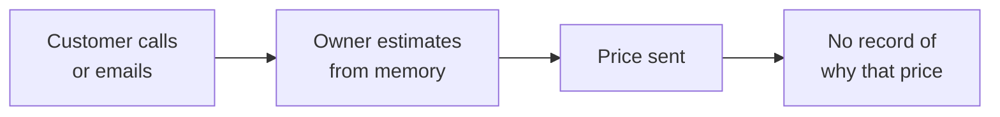
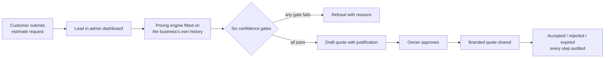
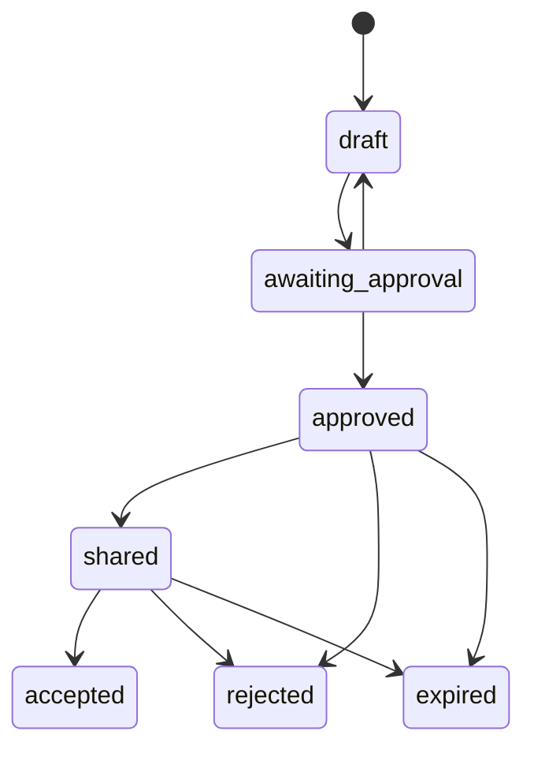

# Business analysis case study: Service-Business Quote Agent

How the product was analysed and specified before and during the build: scope, process, requirements, business rules, acceptance criteria, decisions and the pilot plan.

**Role:** product design, requirements, AI-assisted build and testing · **Timeframe:** July 2026 · **Status:** pilot candidate (local demo on synthetic data, no customer pilot yet)

[← Back to the product showcase](../README.md) · [Article: why the quote agent refuses to guess](refuse-instead-of-guess.md)

---

## 1. Problem statement

Small service businesses lose leads when quotes are slow, and they lose margin when prices are inconsistent. Pricing often lives in one person's head, with no record of why a number was given.

**Goal:** give a single contractor a quoting workflow that is fast, consistent and explainable, without handing pricing decisions to AI.

## 2. Scope

| In scope (pilot) | Out of scope |
|---|---|
| One HVAC or local-service contractor (single tenant) | Multi-tenant SaaS |
| Public estimate request form | Taking payments |
| Admin dashboard: leads, notes, statuses, CSV export | Sending email automatically |
| Deterministic pricing from the business's own quote history | Review automation |
| Approval workflow and branded PDF quote | AI-generated prices |
| Historical quote import with preview | Real customer data before owner validation |

Narrow scope was a deliberate decision: fewer moving parts meant the core workflow could be tested properly.

## 3. Users and stakeholders

| Who | Need | What they control |
|---|---|---|
| **Owner / dispatcher** | Quote quickly and consistently; defend every number | Approves every quote; imports and validates pricing history |
| **Customer** | A clear, non-binding estimate without creating an account | Submits the request and gives consent |
| **Optional AI wording assistant** (system) | Improve quote wording | Nothing: it never sees customer details or prices |

## 4. Process: current state vs future state

**Current state (the problem described above):**

**Future state (as built):**

## 5. Functional requirements

| ID | Requirement |
|---|---|
| FR-01 | A customer can submit an estimate request on a mobile-friendly public form, without logging in. |
| FR-02 | The form records consent and rejects spam (honeypot field, rate limiting, input validation). |
| FR-03 | The owner signs in to a password-protected dashboard to view leads, add notes, set statuses and export CSV. |
| FR-04 | The system calculates a price only from the business's own validated quote history. |
| FR-05 | Before returning a firm price, the system applies six confidence gates (BR-01 to BR-06). |
| FR-06 | If any gate fails, the system returns no price and lists the failed gates. |
| FR-07 | Every quote follows the approval state machine (BR-07) and every state change is recorded. |
| FR-08 | A quote cannot be approved without customer-facing wording. |
| FR-09 | An approved quote can be produced as a branded, print-ready PDF. |
| FR-10 | The owner can import historical quotes from CSV, preview them first, and commit them atomically with duplicate protection. |
| FR-11 | An optional AI assistant can suggest quote wording, and is fully disabled when no server-side key is set. |

## 6. Non-functional requirements

| ID | Category | Requirement |
|---|---|---|
| NFR-01 | Data minimisation | The AI assistant receives only service category, equipment and job description: never name, address, contact details or price. |
| NFR-02 | Accuracy | Money is stored as integer cents to avoid floating-point rounding in totals and tax. |
| NFR-03 | Security | CSRF protection, rate limits, secure HTTP headers, scrypt password hashing. |
| NFR-04 | Privacy | Logs avoid personal data. |
| NFR-05 | Auditability | Every quote state change is stored as an audit event in the same transaction as the status update. |
| NFR-06 | Transparency | Until real history is imported and validated, the system reports that it is running on demo pricing data. |
| NFR-07 | Code quality | Type checks (mypy), linting (Ruff) and dependency auditing. |

## 7. Business rules

**Confidence gates.** A firm price is returned only when all six pass:

| ID | Gate |
|---|---|
| BR-01 | The job matches a known service category. |
| BR-02 | That category has an accepted pricing rule. |
| BR-03 | The job's scope falls within the historical range. |
| BR-04 | There are enough comparable past jobs. |
| BR-05 | Pricing in that category is consistent. |
| BR-06 | Any discount or surcharge rule the job needs is itself accepted. |

**BR-07: quote lifecycle.** Only these transitions are allowed:

## 8. Acceptance criteria (examples)

**FR-06: refusal when data is weak**
> **Given** a request in a category with too few comparable past jobs
> **When** the pricing engine evaluates it
> **Then** no firm price is returned
> **And** the result lists the failed gate, so the owner knows why.

**FR-07 / BR-07: no skipping approval**
> **Given** a quote in `draft`
> **When** anyone tries to move it directly to `shared`
> **Then** the transition is rejected as invalid
> **And** the quote stays in `draft`.

**FR-08: wording required**
> **Given** a quote `awaiting_approval` with empty customer-facing wording
> **When** the owner tries to approve it
> **Then** approval is refused with "add customer-facing wording before approval".

**NFR-01: AI never sees personal data**
> **Given** the AI wording assistant is enabled
> **When** it is asked to draft wording for a quote
> **Then** the request contains only service category, equipment and description
> **And** never the customer's name, address, contact details or the price.

## 9. Verification

18 automated tests, grouped by area:

| Test area | Tests |
|---|---|
| Pricing engine (`tests/test_engine.py`) | 4 |
| Optional AI wording client (`tests/test_model_client.py`) | 6 |
| Web app: intake, admin and workflow (`tests/test_web_app.py`) | 8 |

## 10. Decision log

| Decision | Alternative considered | Why this way |
|---|---|---|
| AI never sets prices | Let a model estimate the price | A customer-facing number must be explainable and repeatable. |
| Refuse instead of guess | Always return a best-effort number | A wrong quote costs margin or trust. "Not enough comparable history" is a useful answer. |
| Mandatory human approval | Auto-send confident quotes | Nothing reaches a customer without the owner's decision. |
| Single tenant, no payments, no email | Build a full SaaS from day one | A narrow pilot can be tested properly. |
| Preview-first data import | Direct upload | The engine is only as good as the history, so import quality matters as much as the quote screen. |

## 11. Risks and pilot plan

| Risk | Mitigation |
|---|---|
| The business's history is too thin, so most requests are refused | Refusals list the failed gates, showing which data to collect next |
| Imported history contains errors or duplicates | Preview before commit, duplicate protection, atomic import |
| Demo data mistaken for real pricing | The system reports demo mode until real history is validated |

**Next step:** a controlled pilot with one contractor. Import their historical quotes, then compare the engine's prices against the quotes they actually sent.

**Proposed pilot measures** (not measured yet):
- share of requests that receive a firm price
- difference between the engine's price and the owner's own quote
- time from request to approved quote

---

© 2026 Samir Mammadli. All rights reserved. See [LICENSE](../LICENSE).
